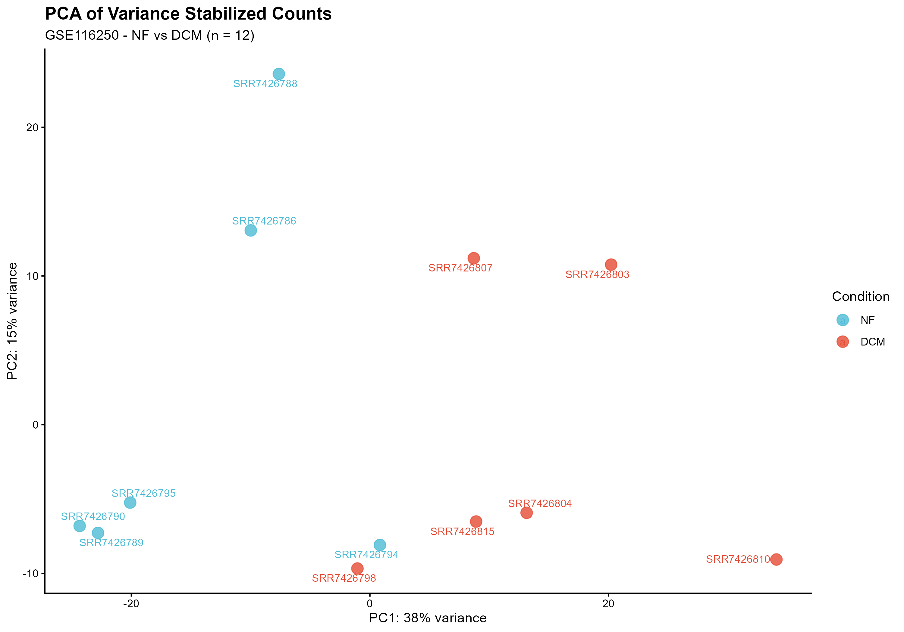

# Cardiac RNA-seq reanalysis

An independent reanalysis of [GSE116250](https://www.ncbi.nlm.nih.gov/geo/query/acc.cgi?acc=GSE116250), comparing gene expression in human left ventricles from six non-failing donors and six patients with dilated cardiomyopathy (DCM). I used Galaxy for read processing and R for the downstream analysis, then compared the results with the [original study by Sweet et al.](https://doi.org/10.1186/s12864-018-5213-9)

**[Read the analysis report](analysis-report.md)** · [Quarto source](GSE116250%20Dilated%20Cardiomyopathy%20RNA-seq%20Reanalysis.qmd) · [Galaxy processing steps](scripts/upstream_pipeline.md)

## Results at a glance



*Figure. Each point represents one sample. The groups mostly separate along PC1, which explains 38% of the variance in this PCA, with some overlap near the center.*

- The DESeq2 comparison, adjusted for age and sex, identified 834 genes with higher expression and 822 with lower expression in DCM at an adjusted p-value below 0.05.
- Extracellular matrix organization and TGF-beta signaling were enriched among genes with higher expression in DCM. The matrix result echoes the original study's findings on cell adhesion and extracellular matrix changes. The [report](analysis-report.md#comparison-with-the-original-study) explains how the sample sizes and methods differ.

## Reproduce the analysis

1. Clone or download this repository. The [12 featureCounts files](data/counts/README.md) and [sample metadata](data/metadata.csv) are included.
2. Install Quarto and use R 4.6.0 with Bioconductor 3.23, the versions recorded for this analysis.
3. From the repository root, run `Rscript scripts/00_install_packages.R`.
4. Render the Quarto source from the repository root.

   ```sh
   quarto render "GSE116250 Dilated Cardiomyopathy RNA-seq Reanalysis.qmd" --to html
   ```

   The HTML render embeds its figures and styles so it can be opened as a single file.

To start from raw reads, use the SRA accessions listed in the [count data notes](data/counts/README.md) and follow the [Galaxy processing steps](scripts/upstream_pipeline.md).

This repository covers the completed 12-sample analysis. The [full-cohort Snakemake workflow](https://github.com/yagmur-t/GSE116250-FULL-RNAseq-Reanalysis-Pipeline) is a separate project in progress.

## Author

Yağmur Taşdemiroğlu · MSc, Biomedical and Veterinary Sciences
