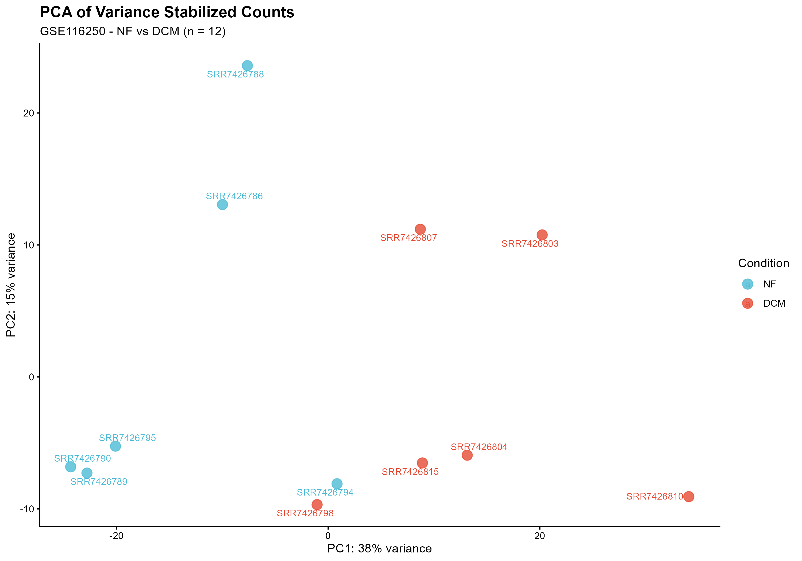
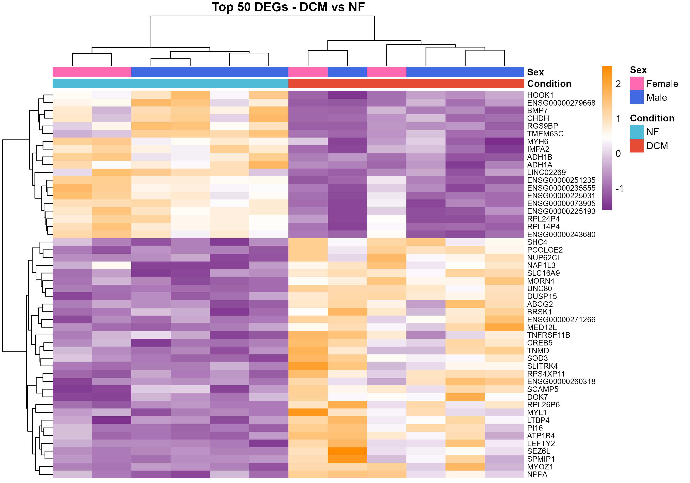
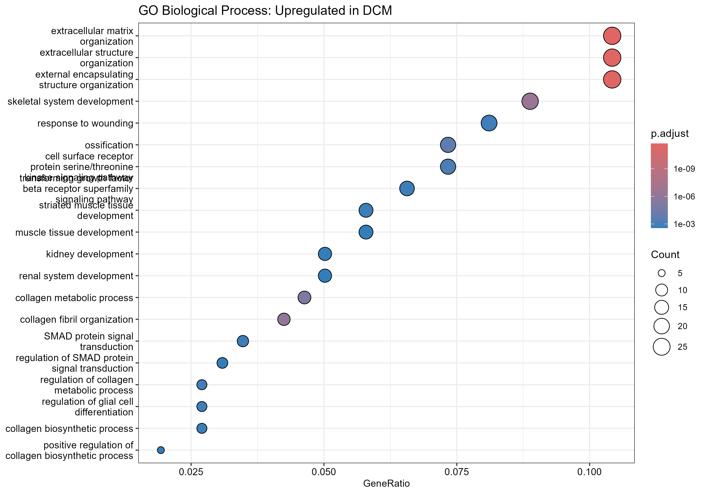

# GSE116250 analysis report

A reading version of the 12-sample Quarto analysis, with the methods, selected figures, and comparison with published work. The [Quarto source](GSE116250%20Dilated%20Cardiomyopathy%20RNA-seq%20Reanalysis.qmd) contains the analysis code. See the [README](README.md#reproduce-the-analysis) for render instructions.

## Study design

The analysis compares six non-failing donor samples with six dilated cardiomyopathy (DCM) samples from human left ventricular tissue. All 12 are part of the public [GSE116250 dataset](https://www.ncbi.nlm.nih.gov/geo/query/acc.cgi?acc=GSE116250). The [sample manifest](data/counts/README.md#samples-used) maps GEO and SRA accessions to each group. The [metadata](data/metadata.csv) records condition, age, and sex.

## Methods

- **Read processing in Galaxy** — Read QC with FastQC and MultiQC, reverse-stranded alignment with HISAT2 against GRCh38, filtering of mitochondrial alignments with SAMtools, and gene-level quantification with featureCounts using Ensembl release 96. [Processing steps and parameters](scripts/upstream_pipeline.md)
- **Differential expression in R** — Kept genes with at least 10 counts in at least six samples. Fit DESeq2 with the design `~ age + sex + condition` and extracted the DCM versus non-failing contrast.
- **Exploratory analysis** — Examined variance-stabilized counts by principal component analysis (PCA). Used clusterProfiler for GO biological process and KEGG over-representation analysis of upregulated and downregulated genes.

## Sample-level quality check

The groups mostly separated along PC1 (38% of the variance in the PCA), with overlap near the center. The same projection can also be viewed by [sex](results/figures/pca_sex.png) and [age](results/figures/pca_age.png). All 12 samples were retained.

## Differential expression

At an adjusted p-value below 0.05, 834 genes had higher expression and 822 had lower expression in DCM. This threshold refers to the adjusted p-value alone. MYH6, which encodes a cardiac contractile protein, was among the genes with lower expression. The heatmap shows the top 50 genes selected from those with an adjusted p-value below 0.05 and an absolute log₂ fold change above 1.

## Pathway enrichment

Extracellular matrix organization was among the most enriched GO biological processes in the upregulated set. The KEGG analysis of the same gene set also identified TGF-beta signaling. Together these results point to changes in genes involved in cardiac remodeling.

[KEGG enrichment for upregulated genes](results/figures/kegg_upregulated.png) · [All saved figures](results/figures/)

## Comparison with the original study

[Sweet et al. (2018)](https://doi.org/10.1186/s12864-018-5213-9) reported changes in cell adhesion and extracellular matrix biology in DCM. The matrix-related signal here is consistent with that observation. The published analysis used 64 samples across three groups, including ischemic cardiomyopathy, and used RPKM-based differential expression and Ingenuity Pathway Analysis. This subset uses 12 samples across two groups, DESeq2, and GO and KEGG. The comparison helps identify shared biological themes across approaches applied to the same source dataset.

A [multi-omics study by Portokallidou et al. (2023)](https://doi.org/10.3389/fcvm.2023.1115623) also examined DCM and ischemic cardiomyopathy using GSE116250. A [study by Dong et al. (2024)](https://doi.org/10.18632/aging.205956) provides additional context on heart failure and gene expression in hypertrophic cardiomyopathy.

The analysis is exploratory at this sample size. Comparisons using the same source dataset show what changes with the analytical approach. Testing whether the patterns generalize would require a separate cohort.
